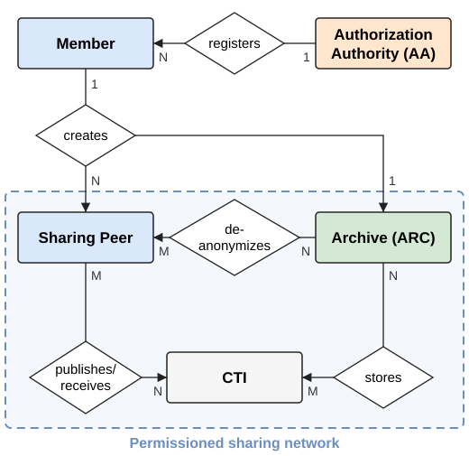
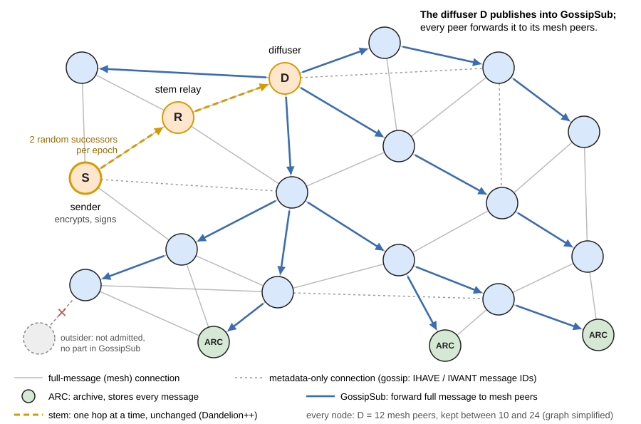
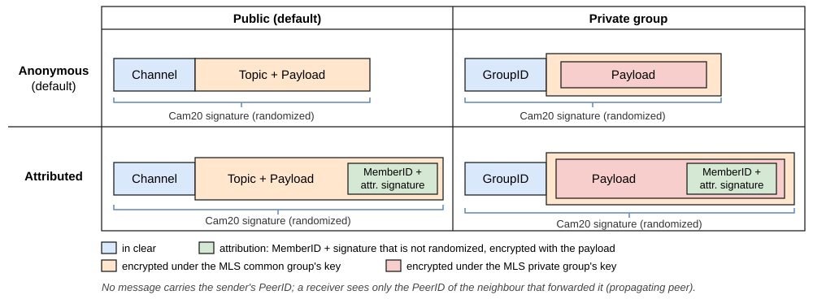

# DACTIE: Decentralized Anonymous CTI Exchange

DACTIE lets organizations share cyber threat intelligence (CTI) without revealing that they were the victim, and still keeps senders accountable. It is a permissioned peer-to-peer network without a blockchain: a sender stays anonymous unless a threshold of archives jointly opens its group signature.

This repository contains the Rust prototype, the experiments, and the first public implementation of the threshold dynamic group signature scheme of Camenisch et al. (2020) that DACTIE builds on.

> **TODO (Vero):** link to the paper and add its BibTeX under [Citation](#citation) -> wait for WAITI ACSAC's 2026 proceedings.

<p align="center">
  
</p>

| Role | Binary | What it does |
| --- | --- | --- |
| **Authorization Authority (AA)** | `dactie-authority` | Admits members and archives and fixes the opening threshold `t`. Can ask for an opening, but cannot open a signature alone. |
| **Archive (ARC)** | `dactie-archive` | Stores every message in its own PostgreSQL database and holds one share of every member key. Its operator approves or denies each opening request. |
| **Member** | – | An organization admitted by the AA. It runs up to `k` sharing peers per epoch (default 5). |
| **Sharing peer** | `dactie-peer` | Publishes and receives CTI. The AA cannot link a sharing peer's PeerID to its member. |

## What DACTIE protects, and what it does not

- **Sender anonymity:** every message carries a group signature that proves "an admitted member sent this" but not which one. No message carries the sender's PeerID.
- **Accountability:** `t` of `n` archives together can open a signature and name the member. Fewer archives cannot, and neither can the AA alone.
- **Confidentiality and integrity:** messages are encrypted with MLS, to all members or to a private group, and signed.
- **Receiver anonymity (partitioned channels):** a topic is not a GossipSub topic of its own. Each topic maps to one of 10 channels, `hash(topic) mod 10` (`NUM_CHANNELS` in `dactie-utils/src/mls_wrapper.rs`). Only the channel travels in clear; the topic is inside the ciphertext. A peer receives every message on its channel and drops the topics it did not subscribe to, so neighbours see which channels a peer joined, but not which topics it reads. Fewer channels hide interests better, at the cost of more traffic per peer.
- **Network-level anonymity:** a stem phase (Dandelion++) hides which peer published a message first. A coalition of `c` colluding peers among `|N_c|` names the sender in about `c/|N_c|` of the cases.
- **Not covered:** CTI content that itself identifies the victim, global passive adversaries, and `t` colluding archives.

## How a message travels

<p align="center">
  
</p>

1. The sender `S` encrypts and signs its message, then passes it unchanged along a random **stem** of sharing peers, one hop at a time.
2. The peer at the end of the stem, the **diffuser** `D`, publishes it into **GossipSub**. Every peer checks the group signature before forwarding, and drops invalid messages.
3. **Archives** subscribe to all channels and store every message.
4. Nodes that are not admitted (the outsider) receive nothing.

A message is public or sent to a private group, and anonymous or attributed:

<p align="center">
  
</p>

| Peer command | Who can read it | Sender shown to readers |
| --- | --- | --- |
| `broad <topic> <msg>` | all members (common group) | `Sender: anonymous` |
| `attr_broad <topic> <msg>` | all members | `Attributed to member: <MemberID>` |
| `enc_broad <group_number> <msg>` | members of one private group | `Sender: anonymous` |
| `attr_enc_broad <group_number> <msg>` | members of one private group | `Attributed to member: <MemberID>` |

Attributed messages skip the stem, since they name their member anyway. Members use them, e.g., to build reputation.

## Quick start: see it work in two minutes

You need [Rust via rustup](https://rustup.rs) (not your distribution's package), Docker (for two PostgreSQL databases) and tmux.

```bash
git clone https://github.com/VeroSec/DACTIE.git && cd DACTIE
cargo build --release
scripts/e2e_local.sh
```

The script starts an AA, two archives and several sharing peers, and checks every step. Each passed check prints `OK …`, and the first failure prints `FAIL: …` and stops. It checks:

- a member joins from a throwaway identity, so the AA never sees its own PeerID;
- a second sharing peer of the same member registers;
- anonymous broadcasts arrive and travel along the stem;
- an unregistered observer receives nothing;
- both archives approve an opening, and it names the right member.

Logs go to `target/e2e/`. The nodes keep running for inspection; stop them with:

```bash
tmux kill-session -t camera; docker rm -f camera-pg1 camera-pg2
```

Two longer runs:

- `scripts/e2e_expiry.sh` (about 3 minutes): sharing peers that do not renew are removed at the end of their epoch.
- `scripts/e2e_nested.sh` (about 5 minutes): private groups, and removing an expired peer from them.

## Walkthrough: run a network by hand

You start one AA, two archives and two sharing peers, each in its own terminal. Build first with `cargo build --release`; all commands below run from the repository root. Lines starting with `>` are typed into a node's console, not the shell.

### 1. Start two databases

```bash
export PGPASSWORD='change-me'   # choose your own database password
for i in 1 2; do
  docker run -d --rm --name dactie-pg$i -e POSTGRES_USER=archive -e POSTGRES_PASSWORD="$PGPASSWORD" \
    -e POSTGRES_DB=archivedb -v "$PWD/init.sql:/docker-entrypoint-initdb.d/init.sql:ro" \
    -p 127.0.0.1:$((5431 + i)):5432 postgres:16
done
mkdir -p km/aa km/arc1 km/arc2 km/peer1 km/peer2
```

Archive 1 uses port 5432 and archive 2 port 5433. The archives read the password from `PGPASSWORD`, so it never appears in a URL or the process list; export it in their terminals too (step 3). If a local PostgreSQL already uses 5432, change both ports here and in step 3.

### 2. Start the authority (terminal 1)

```bash
RUST_LOG=info target/release/dactie-authority -K km/aa
```

It listens on port 10001. Copy its PeerID from the log line `Local PeerId: 12D3KooW…` and set it in every other terminal:

```bash
export AA=12D3KooW…   # the AA's PeerID
```

### 3. Start the archives (terminals 2 and 3), then close the init phase

```bash
RUST_LOG=info target/release/dactie-archive -K km/arc1 -i archive1 -a $AA -B /ip4/127.0.0.1/tcp/10001 \
  -u postgres://archive@127.0.0.1:5432/archivedb
```

```bash
RUST_LOG=info target/release/dactie-archive -K km/arc2 -i archive2 -a $AA -B /ip4/127.0.0.1/tcp/10001 \
  -u postgres://archive@127.0.0.1:5433/archivedb
```

Once both have registered, close the init phase in the AA's console:

```text
> end_init_archive
```

The AA logs `Enough Archives registered, ending init phase (opening threshold 2 of 2)`. This fixes the threshold for good, since every member splits its key for it. The default is a strict majority of the archives; start the AA with `--threshold <t>` to choose another. Do not restart the AA between registering the archives and `end_init_archive`.

### 4. Start two sharing peers and join (terminals 4 and 5)

```bash
RUST_LOG=info target/release/dactie-peer -K km/peer1 -b $AA -B /ip4/127.0.0.1/tcp/10001
```

```text
> register_identity <AA PeerID> org1
```

The peer joins from a throwaway identity (`Joining from throwaway identity …`), and then registers its own PeerID as a sharing peer (`Registering with slot 1 of epoch …`). A node that is not registered gets no messages, and other nodes close its connection after 60 s, so register within a minute of starting; otherwise the node reconnects when you send the request.

Start peer2 the same way with `-K km/peer2`. Then choose one of two options:

- **A second member:** `> register_identity <AA PeerID> org2`
- **A second sharing peer of org1**, which the AA cannot link to peer1:

  ```text
  > get_opener_keys <AA PeerID>
  > peer_from_sig <AA PeerID> km/peer1/key_material.json
  ```

### 5. Share CTI

On both peers:

```text
> sub incidents
```

On peer2:

```text
> broad incidents Indicator: 203.0.113.7 contacted our VPN gateway
```

peer1 prints the message, `Sender: anonymous`, and the message's signature as hex. You need the signature for an opening (step 7).

### 6. Share in a private group

Get peer2's PeerID with `> peer_id`, then on peer1:

```text
> req_kps <peer2 PeerID>
> create_group <peer2 PeerID>
> ls_groups
> enc_broad <group_number> only for this group
```

### 7. Open a signature

In the AA's console:

```text
> req_open <signature hex>
```

Every archive prints `Opening request <id> from the authority is pending`. Each archive operator decides in that archive's console:

```text
> approve <id>
```

Or `> deny <id>`, or `> pending` to list open requests. Pending requests are stored in the archive's database and survive a restart. Once `t` archives have approved, run in the AA's console:

```text
> open <signature hex>
```

It prints the member's ID and name, and every PeerID of that member.

### Clean up

```bash
docker rm -f dactie-pg1 dactie-pg2
rm -rf km   # key material of this test network
```

## Console commands

All options of the three binaries, with defaults, are in [docs/PROTOCOL.md, "Running the nodes"](docs/PROTOCOL.md#running-the-nodes). A peer prints its command list on any unknown command.

**Sharing peer** (`dactie-peer`)

| Command | Effect |
| --- | --- |
| `register_identity <AA PeerID> <name>` | Join as a new member |
| `get_opener_keys <AA PeerID>` | Fetch the archives' keys, the epoch length and `k` (before `peer_from_sig`) |
| `peer_from_sig <AA PeerID> <key_material.json>` | Register this node as another sharing peer of an existing member, using one of its `k` slots |
| `renew <AA PeerID> <key_material.json>` | Keep this sharing peer registered in the next epoch; without it, the AA removes the peer when its epoch ends |
| `sub <topic>` / `unsub <topic>` | Subscribe to or unsubscribe from a topic |
| `broad`, `attr_broad`, `enc_broad`, `attr_enc_broad` | Send a message; see [How a message travels](#how-a-message-travels) |
| `req_kps <PeerID>…` | Request MLS key packages from these peers (before adding them to a group) |
| `create_group <PeerID>…` | Create a private group with these peers |
| `ls_groups` | List private groups with their `group_number` |
| `add_group_member <group_number> <PeerID>` / `remove_group_member <group_number> <PeerID>` | Change a group's members (owner only; the owner cannot be removed) |
| `delete_group_for_all <group_number>` | Delete a group for all its members (owner only) |
| `update_key_material <group_number>` | Renew your own key material in a group |
| `update_groups <archive PeerID>` | Fetch missed group updates from an archive |
| `peer_id` | Print this node's PeerID |

**Authority** (`dactie-authority`): `end_init_archive`, `req_open <signature hex>`, `open <signature hex>`.

**Archive** (`dactie-archive`): `pending`, `approve <id>`, `deny <id>`. With Docker, attach with `docker attach <container>` and detach with `Ctrl+P`, `Ctrl+Q`, which leaves the archive running.

## Settings worth knowing

- **Trusted archives:** start every peer with `--archive /ip4/<ip>/tcp/<port>/p2p/<archive PeerID>` for each archive, published out of band. The peer then checks the archive keys the AA hands out and refuses to join on a mismatch. Without it, the peer warns and trusts the AA's keys.
- **Stem phase:** `--stem-fluff-probability` (default 0.2, Monero's value) is the chance that a peer is a diffuser in an epoch. `0` turns the stem off.
- **Sharing peers per member:** `--peers-per-member <k>` (default 5) and `--epoch-secs` (default 30 days) on the AA.
- **Connections:** each peer keeps between `--conn-low` (50) and `--conn-high` (100) connections.
- **Tests only:** `--auto-approve-open` makes an archive approve every opening without its operator, so the AA could open any signature on its own.

## Several hosts with Docker

`docker-compose.yml` describes the paper's evaluation deployment on four hosts, with one compose profile per host (`node116`–`node119`) and fixed IP addresses. `./build.sh` builds the images, and [RUNBOOK.md](RUNBOOK.md) walks through the deployment and its checks. To try DACTIE on one machine, use the [walkthrough](#walkthrough-run-a-network-by-hand) instead.

## Repository layout

| Folder | Contents |
| --- | --- |
| `dactie-authority`, `dactie-archive`, `dactie-peer` | The three node types ([peer details](dactie-peer/README.md)) |
| `dactie-utils` | Code shared by all nodes: networking, admission, MLS wrapper, message types |
| `thressig` | Threshold dynamic group signatures (Camenisch et al. 2020), single-issuer variant |
| `benchmark` | Microbenchmarks of `thressig` |
| `dactie-experiment-anonymity` | Simulation of the coalition first-spy attack, with and without the stem phase |
| `dactie-experiment-eclipse` | Simulation of eclipse attacks without flood publishing |
| `scripts` | End-to-end tests and measurement helpers |
| `docs` | [PROTOCOL.md](docs/PROTOCOL.md) (every message, check and stored value), [DANDELION.md](docs/DANDELION.md) (stem phase design), figures |

## Reproducing the paper's results

| Result | Where |
| --- | --- |
| Latency and throughput on four hosts | [RUNBOOK.md](RUNBOOK.md) |
| Cost of signing, verifying and opening | [benchmark/README.md](benchmark/README.md) |
| Anonymity against colluding peers | [dactie-experiment-anonymity/README.md](dactie-experiment-anonymity/README.md) |
| Eclipse attacks | [dactie-experiment-eclipse/README.md](dactie-experiment-eclipse/README.md) |

## Limitations of the prototype

- It is a research prototype and has not been audited.
- The AA accepts any unused name; a deployment vets each organization out of band.
- Private groups use P2Panda's workaround for the missing decentralized MLS: only the group owner commits changes, and the owner cannot be removed.

## Citation

> **TODO (Vero):** BibTeX of the paper.

## Contributing

DACTIE is open for contributions: bug reports, fixes, documentation, experiments and research ideas are all welcome.

1. **Understand the protocol first:** [docs/PROTOCOL.md](docs/PROTOCOL.md) lists every message, check and stored value. Change it together with the code it describes.
2. **Test your change:** `scripts/e2e_local.sh` must print only `OK` lines. If you touch groups, peer expiry or the stem, also run `scripts/e2e_nested.sh` or `scripts/e2e_expiry.sh`.
3. **Discuss larger changes first:** open an issue on [GitHub](https://github.com/VeroSec/DACTIE/issues), then a pull request against `main`. Small fixes can go straight to a pull request.

Open problems from the paper and the prototype, a good place to start:

- **Sanctions after an opening:** removing or blocking a member once its signature has been opened.
- **Tor for the first stem hop:** the first stem hop still sees the sender's PeerID; if it colludes, it names the sender.
- **Decentralized MLS:** removes the group-owner workaround in private groups.
- **Admission by several authorities:** today a single AA admits members.
- **Content anonymity:** CTI whose content identifies the victim.
- **AI-Agent contribution:** Add mechanism for AI-Agent-authorization and let them participate to filter traffic and write CTI for participating companies.

By contributing, you agree that your contribution is licensed under the Apache License 2.0, like the rest of the repository.

## License

Apache License 2.0, see [LICENSE](LICENSE).
