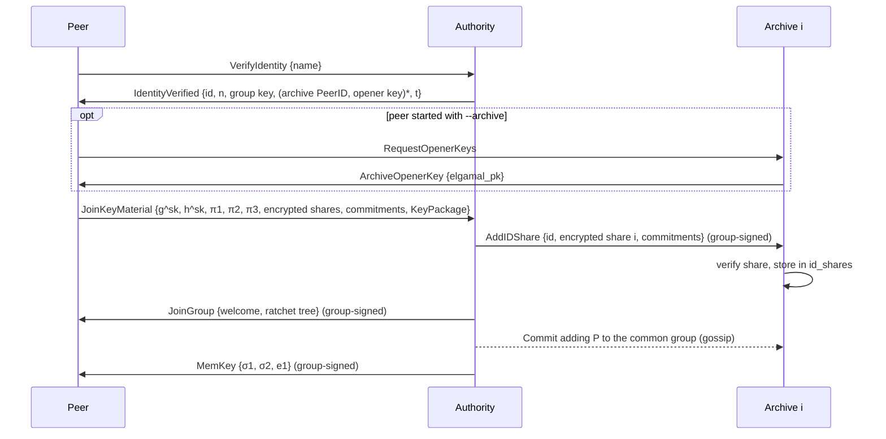

# DACTIE Protocol

This document describes how the DACTIE prototype works at the protocol level: who sends which message to whom, what is checked, and what is stored where. The paper presents the design and its evaluation. This document covers the protocol detail the paper leaves out. For build and usage instructions, see the [README](../README.md).

All statements describe the code in this repository. Message names refer to `dactie-utils/src/shared_structs.rs`.

## Roles

| Role | Crate | Purpose |
| --- | --- | --- |
| Authorization Authority (AA) | `dactie-authority` | Admits members and archives, fixes the opening threshold `t`, owns the common MLS group, and coordinates signature openings. It also joins as member `0` ("Authority"). |
| Archive (ARC) | `dactie-archive` | Stores every message it receives, holds one ElGamal key pair, and stores one encrypted Shamir share of every member key. After its operator approves, it contributes a partial opening. An archive can verify group signatures but cannot create them. |
| Sharing peer | `dactie-peer` | Publishes and receives CTI. A member can run several sharing peers, each with its own PeerID. |

## Identifiers and keys

| Name | What it is | Held by |
| --- | --- | --- |
| PeerID | libp2p peer ID, derived from the node's Ed25519 key in its key-material folder | each node |
| MemberID | Numeric ID derived by hashing the name a member registers with | AA (`gml`: MemberID → name) |
| Group public key / manager key | Keys of the threshold dynamic group signature scheme (`thressig`, Camenisch et al. 2020, single-issuer variant) | AA (manager key); all nodes (group key) |
| Member key | Member secret `sk` plus the AA's credential `(σ1, σ2, e1)` on it | member peers (`key_material.json`) |
| Opener key | ElGamal key pair in G2, one per archive | archive (secret key); AA and peers (public key, with the archive's PeerID) |
| MLS credential | MLS basic credential holding the PeerID bytes | each node |

## Network layer

All nodes use libp2p over TCP with Noise and Yamux. GossipSub is configured as follows (`mybehaviour.rs` of each crate):

- `validate_messages()`: the application checks every message before GossipSub forwards it.
- Maximum message size 8 MiB, instead of the default 64 KiB that silently dropped complete MISP events.
- Sharing peers use `flood_publish(false)` and `MessageAuthenticity::Anonymous`. Without flood publishing, a new message leaves its publisher only towards its mesh peers. Anonymous authenticity puts no author or sequence number into gossip messages.
- All nodes use the mesh band `mesh_n_low = 10`, `mesh_n = 12`, `mesh_n_high = 24` (`dactie-utils/src/net.rs`). GossipSub grafts only below `mesh_n_low` and prunes only above `mesh_n_high`, so the paper's anonymity bound is evaluated at `mesh_n_high`. The experiments in `dactie-experiment-anonymity` and `dactie-experiment-eclipse` set the band themselves with `-D`, `--mesh-n-low` and `--mesh-n-high`.

### Admission to GossipSub

Any libp2p node can connect to a DACTIE node, e.g. to register with the AA or to fetch archive keys, and GossipSub itself has no access control. Every node therefore scores its GossipSub peers by admission (`dactie-utils/src/admission.rs`): PeerIDs in the common MLS group, i.e. the AA, the archives and every registered sharing peer, score 0; all others score −60, below GossipSub's publish threshold. A node never grafts a peer with a negative score into a mesh, prunes such peers at every heartbeat, and sends them neither its own or forwarded messages nor gossip. Subscriptions of non-admitted peers are still recorded, so a new peer joins meshes as soon as the commit that admits it arrives. Like members, non-admitted peers still see which channels a node subscribes to. Nodes re-score their peers whenever the common group changes.

Non-admitted nodes would still occupy connection slots, and PeerIDs cost nothing, so an unregistered node could fill every slot and cut a node off from members. Once a node is admitted itself, it keeps at most 5 non-admitted connections open at once, refuses further ones, and closes each after 60 s, enough to register with the AA or fetch archive keys (`admission::Gate`). Before a node is admitted, the gate does nothing, so a newcomer can reach the AA and the archives.

### Partitioned channels

A topic is not a GossipSub topic of its own. `get_channel` in `dactie-utils/src/mls_wrapper.rs` maps it to one of `NUM_CHANNELS = 10` channels:

```text
channel = "channel_" + (hash(topic) mod 10)      // topics "0".."9" map directly to their channel
```

A peer subscribes to a channel in GossipSub when it subscribes to the first topic in that channel. It receives every message on the channel, but delivers only messages whose topic it subscribed to. Private MLS groups use the channel of their group ID. Archives subscribe to all channels.

### Gossip messages and validation

A gossip message is the bincode encoding of `Message { body: MessageBody, signature }`, where `signature` is a group signature over the encoded body. A receiver:

1. decodes the message;
2. verifies the group signature;
3. reports `MessageAcceptance::Accept` if the signature is valid, so GossipSub forwards the message. This happens before decryption, so peers also forward messages they cannot read;
4. reports `MessageAcceptance::Reject` if the signature is invalid, so the message is dropped and not forwarded.

Direct requests (libp2p request-response) carry an optional group signature. Which requests must be signed is noted in each flow below.

## 1. Archive initialization

Archives must register before any member joins, because every member splits its key into one share per archive.

1. Start the AA, optionally with `--threshold <t>`.
2. Each archive starts with `-i <name>`. If its key file holds no group key, it sends an unsigned `VerifyIdentity { identity: name, with_signature: false }` to the AA.
3. The AA derives the MemberID from the name and rejects empty or already registered names. It replies `IdentityVerified { id, group_key }`.
4. The archive generates its ElGamal key pair and an MLS KeyPackage, and sends `JoinKeyPackage { keypackage, elgamal_pk }`.
5. The AA records the archive's PeerID and ElGamal key, keeps the KeyPackage, and replies `MemKey { None }`. Archives therefore receive no member key. The position of an archive in this list is the index of the share it will hold.
6. The operator runs `end_init_archive` on the AA:
   - At least two archives must be registered.
   - `t` is set to `--threshold` or, by default, a strict majority (`⌊n/2⌋ + 1`), with `1 ≤ t ≤ n`. The value is stored and cannot change afterwards, because every member key is shared for it.
   - The AA joins as member `0`.
   - The AA creates the common MLS group with all archives, becomes its owner, and sends each archive a group-signed `JoinGroup { welcome, ratchet_tree }`. Archives accept `JoinGroup` for the common group only from the AA.
   - The AA sends each archive its share of the AA's own member key in `AddIDShare`.

The AA keeps the archives' KeyPackages in memory only, so do not restart it between archive registration and `end_init_archive`.

## 2. Member registration

Console: `register_identity <AA PeerID> <name>`.



1. **Identity.** The peer sends `VerifyIdentity { name, with_signature: true }`. In a deployment, this is where the AA would vet the organization out of band. The prototype accepts any new name. The AA derives the MemberID from the name, draws a random nonce `n`, and remembers `(n, MemberID, name)` under the requesting PeerID until the join completes.
2. **Join parameters.** The AA replies `IdentityVerified` with the MemberID, `n`, the group public key, every archive's opener key paired with its PeerID, and `t`.
3. **Archive key check.** If the peer was started with `--archive <multiaddr>/p2p/<PeerID>` (repeatable), it asks each listed archive for its key directly (`RequestOpenerKeys` → `ArchiveOpenerKey`) and compares it with the key the AA sent. On a mismatch, the peer abandons the join. This keeps a dishonest AA from substituting archive keys it controls. Without `--archive`, the peer logs a warning and trusts the AA's keys.
4. **Key material** (`thressig::join_mem1`, `create_enc_shares`). The peer
   - chooses its secret `sk` and computes `g^sk` and `h^sk` with `h = g^{H0(MemberID)}`;
   - proves knowledge of both discrete logarithms, bound to `n` (`π1`, `π2`);
   - blinds `h` with a random `α` and Shamir-shares `sk` with a polynomial of degree `t − 1`, publishing `t` Feldman commitments under the blinded base;
   - encrypts share `i` with archive `i`'s ElGamal key and attaches a proof that the ciphertext matches the commitments;
   - proves that the first commitment hides the same `sk` as `h^sk` (`π3`, equality of discrete logarithms, bound to `n`).

   It sends all of this, together with an MLS KeyPackage, in `JoinKeyMaterial`. `sk` never leaves the peer.
5. **AA checks** (`thressig::join_mgr2`). The AA checks:
   - the number of commitments equals `t`, and the number of shares equals the number of archives;
   - the MemberID is new;
   - `π1` and `π2` against `n`;
   - that all shares use one base and share `i` has index `i + 1`, so any `t` archives can interpolate;
   - `π3`, so the shares hide the `sk` the credential is issued on. Otherwise a member could share another secret and never be opened;
   - every encrypted share against its archive's key and the commitments.

   It then issues the credential `(σ1, σ2, e1)` on `sk` without learning `sk`, and records `MemberID → name` in `gml`.
6. **Shares to archives.** The AA sends archive `i` a group-signed `AddIDShare { id, enc_share_i, commitments }`. The message carries no PeerID. The archive verifies the AA's signature and the share against its own key, then stores it in `id_shares`.
7. **Common MLS group.** The AA checks that the KeyPackage's credential matches the requesting PeerID. It then adds the peer to the common group with a commit, which it publishes on the group's channel, and sends the peer a group-signed `JoinGroup` welcome.
8. **Member key.** The AA sends `MemKey { σ1, σ2, e1 }`. The peer combines it with `sk` and can now sign.

**What the AA learns.** The AA learns the member's name and MemberID. Because the request arrives over the peer's libp2p connection, the AA also sees the PeerID the member registered from. After the join, the AA keeps `gml` (MemberID → name) and the list of admitted PeerIDs separately. It never sees `sk` or any share in the clear.

## 3. Additional sharing peers

A member can run further sharing peers under the same member key. Each new peer has its own PeerID and MLS credential, and costs one registration token, so that `m` colluding members run at most `m·k` sharing peers per epoch.

**Registration tokens** (`thressig/src/tokens.rs`, blind BLS signatures). The AA is started with `--epoch-secs` (default 30 days) and `--peers-per-member` `k` (default 5), and derives one token key per epoch from a secret in its storage.

- `get_tokens <AA PeerID> [count]` on the member's **registration peer**: the peer draws `count` random serials, blinds `H(epoch, serial)`, keeps the blinding factors in `tokens.json` in its key folder, and sends the unsigned `RequestTokens { epoch, blinded }`.
- The AA answers only the PeerID the member registered from, and only for the current epoch; otherwise `TokensRefused { current_epoch }`, after which the peer asks again for that epoch. It signs at most `k` tokens per member and epoch and returns `Tokens { epoch, signed, epoch_pubkey }`. Because the tokens were blinded, it cannot recognize them later.
- The peer unblinds the signatures, checks each against `epoch_pubkey`, and stores the tokens in `tokens.json`. A token signed with another key, e.g. one the AA keeps for this member to recognize it later, fails the check and is discarded. All members must see the same epoch key for this check to protect them.

1. `get_opener_keys <AA PeerID>`: the new peer fetches the archives' keys and `t` (`RequestOpenerKeys` → group-signed `OpenerKeys`). If the peer was started with `--archive`, it confirms them as in step 3 above.
2. `peer_from_sig <AA PeerID> <key_material.json of an existing peer>`: the new peer loads the member key, shares the same `sk` again with fresh blinding and a fresh polynomial, takes one token from the `tokens.json` next to that file, and sends a **group-signed** `AddPeerToSig { keypackage, enc_shares, commitments, share_link, token }`. Because the request is group-signed, the AA learns only that the requester is some admitted member, not which one. `share_link` proves that the shares hide the `sk` of a valid member credential: a freshly randomized credential and one Schnorr proof for both the credential equation and the first commitment, bound to the KeyPackage. It reveals no more about the member than a group signature.
3. The AA checks `share_link` and the share layout, the KeyPackage credential against the requesting PeerID, the share count, and every encrypted share. Last, it accepts the token if it belongs to the current epoch, carries the AA's signature, and has not been spent, and records its serial. It then sends archive `i` a group-signed `AddPeerShare { peer_id, enc_share_i, commitments }`, adds the peer to the common group, and replies `PeerAdded`.
4. Each archive verifies the share and stores it in `peer_shares` under the new PeerID.

Archives store `id_shares` per MemberID without any PeerID, and `peer_shares` per additional PeerID without any MemberID. Only an opening links the two.

## 4. Publishing and receiving CTI

| Console | Gossip message | Encryption | Readable by |
| --- | --- | --- | --- |
| `sub <topic>` | none (subscribes to the topic's channel) | — | — |
| `broad <topic> <msg>` | `BroadcastEnc { topic, data, nonce }` | AES-256-GCM with a random 96-bit nonce, under a key exported from the common MLS group's current epoch | all members (the common group) |
| `enc_broad <group> <msg>` | `GroupEnc { group_id, enc_data, nonce }` | AES-256-GCM under a key exported from the private group's current epoch | members of that private group |

Topic and group ID travel unencrypted, so that peers can filter messages before decrypting them. The exported keys change with every MLS epoch. The sender signs the whole encoded body (topic or group ID, ciphertext, nonce) with its group signature and publishes it on the channel of the topic or group.

A receiver validates the signature (see [Gossip messages and validation](#gossip-messages-and-validation)). It then decrypts a `BroadcastEnc` only if it subscribed to the topic, and a `GroupEnc` only if it is a member of the group. It ignores all other messages, but still forwards them.

Messages are anonymous: neither the gossip message nor the group signature identifies the sender. A sender who wants attribution writes its MemberID into the payload, where the group signature protects it against modification in transit.

## 5. MLS groups

- `req_kps <PeerIDs>`: collect KeyPackages from the peers to be added. Requests and answers are group-signed.
- `create_group <PeerIDs>`: the creator becomes the group's **owner** (leaf 0). It adds the peers with a commit, publishes the commit on the group's channel, and sends the new members a group-signed `JoinGroup` welcome.
- `add_group_member`, `remove_group_member`, `update_key_material`: any member publishes these as **proposals**.
- **Only the owner commits.** When the owner receives a proposal, it commits all pending proposals and publishes the commit after a short delay. Receivers reject commits from any other member. In an unordered peer-to-peer network, concurrent commits from different members would otherwise fork the group. Proposals to remove the owner are ignored. If a non-owner proposed an Add, it sends the welcome once it has processed the owner's commit.
- The **common group** is owned by the AA. The AA adds every member and every additional peer by direct commit. Peers cannot address the common group from the console.

## 6. Archive storage

Each archive writes to its own PostgreSQL database (`init.sql`):

| Table | Content | Form |
| --- | --- | --- |
| `broadcast(id, topic, data)` | common-group messages | **decrypted** (archives are members of the common group) |
| `group_enc(id, group_id, data, nonce)` | private-group messages | ciphertext (archives are not members of private groups) |
| `proposal`, `commit` | MLS proposals, commits and welcomes, with group ID and epoch | as received |
| `id_shares(id, enc_share, commits)` | one encrypted share per MemberID | ElGamal ciphertext |
| `peer_shares(peer_id, enc_share, commits)` | one encrypted share per additional PeerID | ElGamal ciphertext |
| `pending_opens(id, signature, received_at)` | opening requests awaiting the operator | — |

`id` is the GossipSub message ID, a hash of the message content. Data is kept indefinitely.

**Catching up.** A peer that was offline sends a group-signed `Update { group_id, epoch }` to an archive for each private group. The archive returns all stored commits after that epoch and all proposals from that epoch on, and the peer applies them in order. The archive ignores `Update` requests without a valid group signature. Stored CTI messages are not served over the network: they can be searched in the archive's database, e.g. through the Adminer interface of the Docker setup.

## 7. Opening a signature

Opening reveals the member behind a group signature. It needs the AA and at least `t` archives whose operators agree. The AA can ask, but each archive operator decides.

1. **Request.** The AA operator runs `req_open <signature hex>`. The AA sends a group-signed `RequestOpen { signature }` to every archive. Archives act on opening requests only if they come from the AA.
2. **Approval.** Each archive stores the request in `pending_opens`, prints its ID, and replies `OpenPending`. Its operator reviews the evidence and runs `approve <id>` or `deny <id>` (`pending` lists open requests). `--auto-approve-open` skips this step and is meant for automated tests only.
3. **Partial opening.** On `approve`, the archive decrypts the pairing form of each of its stored shares. The signer is unknown, so it does this for **every** row in `id_shares` and `peer_shares`, computing `e(σ1, Ỹ1^{s_i})` with its ElGamal secret key. It sends the results to the AA in `SubmitOpenPairings`. The AA accepts these only from registered archives. The cost grows linearly with the number of members, which keeps openings deliberate and rare.
4. **Combination.** Once partial openings from at least `t` distinct share indices are in, the AA operator runs `open <signature hex>`. For every MemberID in `gml`, the AA combines the archives' pairings with Lagrange coefficients and checks them against the signature (`thressig::open`). It repeats this for every admitted PeerID using `peer_shares`.
5. **Result.** The AA prints the matching MemberID and name, and every additional PeerID of that member. It then deletes the stored pairings for this signature.

Sharing peers cannot request openings. A peer that observes misbehavior reports the signature, which the receiving console prints as hex, to the AA out of band.

## Relation to the Camenisch et al. scheme

DACTIE uses the Short Threshold Dynamic Group Signatures of Camenisch, Drijvers, Lehmann, Neven and Towa (2020), with one issuer, the AA, instead of a distributed issuer and a public ledger. The member list (`gml`) lives at the AA, and the per-member opening shares live in the archives' databases. Joining follows the scheme's `GJoin` protocol: the member proves knowledge of `sk`, Shamir-shares it to the openers under ElGamal encryption, and receives a credential on `sk`. The prototype adds two steps: the member may first confirm the openers' keys with the openers themselves, and a member adding a sharing peer proves with `share_link` that the new shares hide its key, since the issuer cannot see which member asks. Signing and verification are unchanged.
