# Performance Benchmarking and Optimizing Hyperledger Fabric Blockchain Platform

Parth Thakkar\* National Institute of Technology, Trichy, India *pthakker@in.ibm.com*

Senthil Nathan N IBM Research Lab, India *snatara7@in.ibm.com*

Balaji Viswanathan IBM Research Lab, India *bviswana@in.ibm.com*

*Abstract*—The rise in popularity of permissioned blockchain platforms in recent time is significant. Hyperledger Fabric is one such permissioned blockchain platform and one of the Hyperledger projects hosted by the Linux Foundation [13]. The Fabric comprises of various components such as smartcontracts, endorsers, committers, validators, and orderers. As the performance of blockchain platform is a major concern for enterprise applications, in this work, we perform a comprehensive empirical study to characterize the performance of Hyperledger Fabric and identify potential performance bottlenecks to gain a better understanding of the system.

We follow a two-phased approach. In the first phase, our goal is to understand the impact of various configuration parameters such as block size, endorsement policy, channels, resource allocation, state database choice on the transaction throughput & latency to provide various guidelines on configuring these parameters. In addition, we also aim to identify performance bottlenecks and hotspots. We observed that (1) endorsement policy verification, (2) sequential policy validation of transactions in a block, and (3) state validation and commit (with CouchDB) were the three major bottlenecks.

In the second phase, we focus on optimizing Hyperledger Fabric v1.0 based on our observations. We introduced and studied various simple optimizations such as aggressive caching for endorsement policy verification in the cryptography component (3× improvement in the performance) and parallelizing endorsement policy verification (7× improvement). Further, we enhanced and measured the effect of an existing bulk read/write optimization for CouchDB during state validation & commit phase (2.5× improvement). By combining all three optimizations1 , we improved the overall throughput by 16× (i.e., from 140 tps to 2250 tps).

# I. INTRODUCTION

Blockchain technologies initially gained popularity as they were seen as a way to get rid of the intermediary and decentralize the system. Since then, blockchain has witnessed a growing interest from different domains and use cases. A blockchain is a shared, distributed ledger that records transactions and is maintained by multiple nodes in the network where nodes do not trust each other. Each node holds the identical copy of the ledger which is usually represented as a chain of blocks, with each block being a logical sequence of transactions. Each block encloses the hash of its immediate previous block, thereby guaranteeing the immutability of ledger.

Blockchain is often hailed as a new breed of database systems, in essence being a distributed transaction processing system where the nodes are not trusted and the system needs to achieve Byzantine fault tolerance [18]. Blockchain provides serializability, immutability, and cryptographic verifiability without a single point of trust unlike a database system; properties that have triggered blockchain adoption in a wide variety of industries.

A blockchain network can be either permissionless or permissioned. In a permissionless network or public network such as Bitcoin [28], Ethereum [20], anyone can join the network to perform transactions. Due to a large number of nodes in a public network, a proof-of-work consensus approach is used to order transactions and create a block. In a permissioned network, the identity of each participant is known and authenticated cryptographically such that blockchain can store who performed which transaction. In addition, such a network can have extensive access control mechanisms built-in to limit who can (a) read & append to ledger data, (b) issue transactions, (c) administer participation in the blockchain network.

A permissioned network is highly suitable for enterprise applications that require authenticated participants. Each node in a permissioned network can be owned by different organizations. Further, enterprise applications need complex data models and expressibility which can be supported using *smartcontracts* [29]. Enterprises find value in being able to integrate diverse systems without having to build a centralized solution and to bring a level of trust among untrusting parties or to bring in a trusted third-party. Trade Finance [26] and Food Safety [21] are examples of blockchain applications where participants see value in visibility advantages it offers as compared to the existing loosely coupled centralized systems.

There is a lot of concern about the performance of permissioned blockchain platforms and their ability to handle a huge volume of transactions at low latency. Another concern is the richness of language to describe the transactions. Different blockchain platforms such as Quorum [14], Corda [25] address these concerns using different techniques derived from the distributed systems domain. Hyperledger Fabric [16] is an enterprise-grade open-source permissioned blockchain platform which has a modular design and a high degree of specifiability through trust models and pluggable components. Fabric is currently being used in many different use cases such as Global Trade Digitization [33], SecureKey [15], Everledger [5] and is the focus of our performance study.

Fabric consists of various components such as endorsers, ordering service, and committers. Further, it constitutes various phases in processing a transaction such as endorsement phase, ordering phase, validation and commit phase. Due to numerous

\*Work done as part of undergraduate internship at IBM

1These optimizations are successfully adopted in Hyperledger Fabric v1.1

components and phases, Fabric provides various configurable parameters such as block size, endorsement policy, channels, state database. Hence, one of the main challenges in setting up an efficient blockchain network is finding the right set of values for these parameters. For e.g., depending on the application and requirements, one might need to answer the following questions:

- What should be the block size to achieve a lower latency?
- How many channels can be created and what should be the resource allocation?
- What types of endorsement policy is more efficient?
- How much is the performance difference between GoLevelDB [7] and CocuhDB [2] when it is used as the state database?

To answer above questions and to identify the performance bottlenecks, we perform a comprehensive empirical study of Fabric v1.0 with various configurable parameters. Specifically, our three major contributions are listed below.

- 1) We conducted a comprehensive empirical study of Fabric platform by varying values assigned to the five major parameters by conducting over 1000s of experiments. As a result, we provide six guidelines on configuring these parameters to attain the maximum performance.
- 2) We identified three major performance bottlenecks: (i) crypto operations, (ii) serial validation of transactions in a block, and (iii) multiple REST API calls to CouchDB.
- 3) Introduced and studied three simple optimizations2 to improve the overall performance by 16× (i.e., from 140 tps to 2250 tps) for a single channel environment.

The rest of the paper is organized as follows: §II presents the architecture of Hyperledger Fabric. §III briefly describes the goals of our study while §IV delve into the experimental setup and workload characteristics. §V and §VI present our core contributions while §VII describes related work. Finally, we conclude this paper in §VIII.

# II. BACKGROUND: HYPERLEDGER FABRIC ARCHITECTURE & CONFIGURATION PARAMETERS

The Hyperledger Fabric is an implementation of permissioned blockchain system which has many unique properties suited for enterprise-class applications. It can run arbitrary smart contracts (*a.k.a* chaincodes [1]) implemented in Go/JAVA/Nodejs language. It supports an application specifiable trust model for transaction validation and a pluggable consensus protocol to name a few. A Fabric network consists of different types of entities, peer nodes, ordering service nodes and clients, belonging to different organizations. Each of these has an identity on the network which is provided by a Membership Service Provider (MSP) [9], typically associated with an organization. All entities in the network have visibility to identities of all organizations and can verify them.

# *A. Key Components in Fabric*

Peer. A peer node executes the chaincode, which implements a user smart-contract, and maintains the ledger in a file

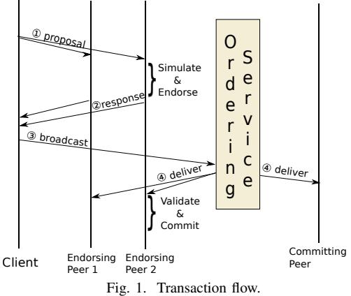

system. The chaincode is allowed access to the shared state by well-defined ledger APIs. A peer is further segregated as an endorsing peer, one which has the chaincode logic and executes it to endorse a transaction or a committing peer, one which does not hold the chaincode logic. Irrespective of this differentiation, both types of peer maintain the ledger. Additionally, both peers maintain the current state as *StateDB* in a key-value store such that chaincode can query or modify the state using the database query language.

*Endorsement Policies.* Chaincodes are written in generalpurpose languages that execute on untrusted peers in the network. This poses multiple problems, one of non-deterministic execution and the other of trusting the results from any given peer. The endorsement policy addresses these two concerns, by specifying as part of an endorsement policy, the set of peers that need to simulate the transaction and endorse or digitally sign the execution results. Endorsement policies3 are specified as boolean expressions over network principals identities. A principal here is a member of a specific organization.

*System chaincodes.* System chaincode has the same programming model as normal user chaincodes and is built into the peer executable, unlike user chaincodes. Fabric implements various system chaincodes; the life cycle system chaincode (LSCC)—to install/instantiate/update chaincodes; the endorsement system chaincode (ESCC)—to endorse a transaction by digitally signing the response; the validation system chaincode (VSCC)—to validate a transaction's endorsement signature set against the endorsement policy; the configuration system chaincode (CSCC) – to manage channel configurations.

*Channel.* Fabric introduces a concept called channel as a "private" subnet of communication between two or more peers to provide a level of isolation. Transactions on a channel are only seen by the peer members and participants. The immutable ledger and chaincodes are on a per-channel basis. Further, the consensus is applicable on a per-channel basis, i.e., there is no defined order for transaction across channels.

Ordering Service. An Ordering Service Node (OSN), participate in the consensus protocol and *cuts* block of trans-

2Source code is available in https://github.com/thakkarparth007/fabric

3AND('Org1.member', 'Org2.member', 'Org3.member') requests a signature from each of the three organization while OR('Org1.member', AND ( 'Org2.member', 'Org3.member' )) requests either a signature from organization 1 or two signatures, i.e., from both organization 2 & 3.

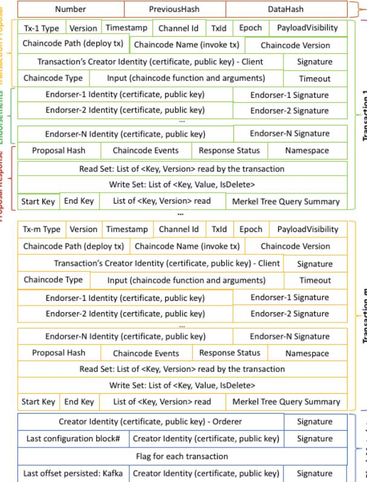

Fig. 2. Block Structure in Hyperledger Fabric v1.0

actions which is delivered to the peers by a gossip communication protocol. The structure of a block in Fabric v1.0 is shown in Figure 2. The ordering service is modular and supports a pluggable consensus mechanism. By default, a serial ordering (i.e., consensus) is achieved using an underlying Kafka/Zookeeper cluster. OSNs publish transactions to kafka topics and leverages the ordered and immutable nature of records in kafka topic to generate a unique ordered sequence of transactions in a block. A block is cut, when either a maximum number of new transactions, since the last block cut, are added added or a configured timeout since the last block cut has occurred. When any one condition is satisfied, an OSN, publishes a time-to-cut marker and cut a block of all transactions message offsets since the last time-to-cut message offset. The block is then delivered to the peer nodes.

Client. The client application is responsible for putting together a transaction proposal as shown in Figure 2. The client submits the transaction proposal to 1-or-more peers simultaneously for collecting proposal responses with endorsements to satisfy the endorsement policy. It then *broadcasts* the transaction to the orderer to be included into a block and delivered to all peers for validation and commit. In Fabric v1.0, the onus is on the client to ensure that the transaction is well-formed and satisfies the endorsement policies.

# *B. Transaction Flow in Hyperledger Fabric*

Unlike other Blockchain network which employ an orderexecute [32] transaction model, the Fabric employs a simulateorder-validate & commit model. Figure 1 depicts the transaction flow which involves 3 steps, 1) Endorsement Phase – simulating the transaction on selective peers and collecting the state changes; 2) Ordering Phase – ordering the transactions through a consensus protocol; and 3) Validation Phase – validation followed by commit to ledger. Before transactions can be submitted on Fabric, the network needs to be bootstrapped with participating organizations, their MSPs and identities for peers. First, a channel is created on the orderer network with respective organization MSPs. Second, peers of each organization join the channel and initializes the ledger. Finally, the required chaincodes are installed on the channel.

Endorsement Phase. A client application using the Fabric SDK [8], [6], [10], constructs a transaction proposal to invoke a chaincode function which in-turn will perform read and/or write operations on the ledger state. The proposal is signed with the client's credentials and the client sends it to 1-or-more endorsing peers simultaneously. The endorsement policy for the chaincode dictates the organization peers the client needs to send the proposal to for simulation.

First, each endorsing peer verifies that the submitter is authorized to invoke transactions on the channel. Second, the peer executes the chaincode, which can access the current ledger state on peer. The transaction results include response value, read-set and write-set. All reads read the current state of ledger, but all writes are intercepted and modify a private transaction workspace. Third, the endorsing peer calls a system chaincode called ESCC which signs this transaction response with peer's identity and replies back to client with proposal response. Finally, the client inspects the proposal response to verify that it bears the signature of the peer. The client collects enough proposal response from different peers, verifies that the endorsements are same. Since each peer could have executed the transaction at different *height* in the blockchain, it is possible that the proposal response differs. In such cases, the client has to re-submit the proposal to other peers, to obtain sufficient matching responses.

Ordering Phase. The client *broadcasts* a well-formed transaction message to the Ordering Service. The transaction will contain the read-write sets, the endorsing peer signatures and the Channel ID. The ordering service does not need to inspect the contents of the transaction to perform its operation. It receives transactions from different clients for various channels and *enqueues* them on a per-channel basis. It creates blocks of transactions per channel, sign the block with its identity and *delivers* them to peers using gossip messaging protocol.

Validation Phase. All peers, both endorsing and committing peers on a channel receive blocks from the network. The peer first verifies the Orderer's signature on the block. Each valid block is decoded and all transactions in a block goes through VSCC validation first before performing MVCC validation.

*VSCC Validation.* A Validation system chaincode evaluates endorsements in the transaction against the endorsement policy specified for the chaincode. If the endorsement policy is not satisfied, then that transaction is marked invalid.

*MVCC Validation.* As the name implies, the Multi-Version

Concurrency Control [30] check ensures that the versions of keys read by a transaction during the endorsement phase are same as their current state in the local ledger at commit time. This is similar to a read-write conflict check done for concurrency control, and is performed sequentially on all the valid transactions in the block (as marked by VSCC validation). If the read-set versions do not match, denoting that a concurrent previous (as-in earlier in this block or before) transaction modified the data read and was since (it's endorsement) successfully committed, the transaction is marked invalid. To ensure that no phantom reads occur, for range queries, the query is re-executed and compares the hashes of results (which is also stored as part of read-set captured during endorsement).

Ledger Update Phase. As the last step of transaction processing, the ledger is updated by appending the block to the local ledger. The *StateDB*, which holds the current state of all keys is updated with the write-sets of valid transactions (as marked by MVCC validation). These updates to the StateDB are performed atomically for a block of transactions and applies the updates to bring the StateDB to the state after all transaction in the block have been processed.

# *C. Configuration Parameters*

Our goal is to study the performance of Fabric under various conditions to understand how choices of different facets of the system affect performance. However, the parameter space is wide and we limit our choices to comprehensively cover a few components and look widely at other aspects of the system so that we can identify interplay of component level choices. To this end, we choose to understand and characterize the overall performance primarily from a peer's perspective. More specifically, we keep the Orderer, Gossip (physical network) etc. static so that it does not affect our experiments and observations. Next, we describe the five parameters considered in this study and their significance.

1) Block Size. Transactions are batched at the orderer and delivered as a block to peers using a gossip protocol. Each peer processes one block at a time. Cryptographic processing like orderer signature verification is done per-block unlike transaction endorsement signatures verification, which is pertransaction. Varying blocksize also brings in the throughputvs-latency tradeoff and for a better picture, we study it in conjunction with the transaction arrival rate.

2) Endorsement Policy. An endorsement policy dictates how many executions of a transaction and signing need to happen before a transaction request can be submitted to the orderer so that the transaction can pass the VSCC validation phase at peers. The VSCC validation of a transaction' endorsements require evaluation of endorsement policy expression against the collected endorsements and checking for satisfiability [24], which is NP-Complete. Additionally, a check includes verifying that the identity and its signature. The complexity of the endorsement policy will affect resources and the time taken to collect and evaluate it.

3) Channel. Channels isolate transactions from one another. Transactions submitted to different channels are ordered, deliv-

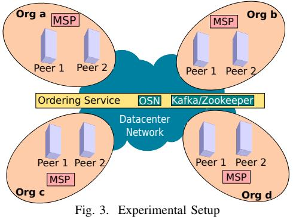

ered and processed independent of each other, albeit on same peers. Channels bring inherent parallelism to various aspects of transaction processing in the Fabric. While number of channels to use, and what channels to transact on is determined by the application and participant combinatorics, it has significant implications on platform performance and scalability.

4) Resource Allocation. Peers run CPU-intensive signature computation and verification routines as part of system chaincodes. User chaincodes executed by endorsing peers during transaction simulation add to this mix. We vary the number of CPU cores on peer nodes to study its effect. While network characteristics are important, we assume a datacenter or high bandwidth network with very low latency for this study.

5) Ledger Database. Fabric supports two alternatives for key-value store, CouchDB [2] and GoLevelDB [7] to maintain the current state. Both are key-value stores, while GoLevelDB is an embedded database, CouchDB uses a client-server model (accessed using REST API over a secure HTTP) and supports document/JSON data-model.

# III. PROBLEM STATEMENT

# The two primary goals of our work are:

1) Performance Benchmarking. To conduct an in-depth study of Fabric core components and benchmark Fabric performance for common usage patterns. We aim to study the throughput and latency characteristics of the system when varying the configuration of parameters listed §II-C to understand the relationship between the performance metrics and parameters. Based on our observations, we aim to derive and present a few high-level guidelines, which would be valuable to developers and deployment engineers.

2) Optimization. To identify bottlenecks using code-level instrumentation and to draw out action items to improve the overall performance of Fabric. On identifying bottlenecks, our goal is to introduce and implement optimizations to alleviate these bottlenecks.

# IV. EXPERIMENTAL METHODOLOGY

We study the throughput and latency as the primary performance metrics for Fabric. *Throughput* is the rate at which transactions are committed to ledger. *Latency* is the time taken from application sending the transaction proposal to the transaction commit and is made up of the following latencies:

TABLE I DEFAULT CONFIGURATION FOR ALL EXPERIMENTS UNLESS SPECIFIED

| OTHERWISE.             |                                        |  |
|------------------------|----------------------------------------|--|
| Parameters             | Values                                 |  |
| Number of Channels     | 1                                      |  |
| Transaction Complexity | 1 KV write (1-w) of size 20 bytes      |  |
| StateDB Database       | GoLevelDB                              |  |
| Peer Resources         | 32 vCPUs, 3 Gbps link                  |  |
| Endorsement Policy  | OR [AND(a ,b, c), AND(a, b, d), AND(b, |  |
| AND/OR                 | c, d), AND(a, c, d)]                   |  |
| Block Size             | 30 transactions per block              |  |
| Block Timeout          | 1 second                               |  |

- *Endorsement latency* the time taken for the client to collect all proposal responses along with the endorsements.
- *Broadcast latency* the time delay between client submitting to orderer and orderer acknowledges the client.
- *Commit latency* the time taken for the peer to validate and commit the transaction.
- *Ordering latency* the time transaction spent on the ordering service. As the performance of ordering service is not studied in this work, we are not presenting this latency.

Further, we define the following three latency at block level:

- *VSCC validation latency* the time taken to validate all transactions' endorsement signature set (in a block) against the endorsement policy.
- *MVCC validation latency* the time taken to validate all transactions in a block by employing multi-version concurrency control as described in §II-B.
- *Ledger update latency* the time taken to update the state database with write-set of all valid transactions in a block.

Since one of the major goal of this work is to identify performance bottlenecks, our load generator4 spans multiple clients each stresses the system by continuously generating transactions instead of following a distribution model (say, Poisson). Each client also sends proposal requests in parallel and collates endorsements. The transactions are submitted asynchronously to achieve the specified rate without waiting for commits. However, the benchmark framework tracks commit using our tools named *fetch-block*5 to calculate throughput and latency. Further, we instrumented the Fabric source code to collect fine-grained latency such as MVCC latency and others latencies. For multi-channel experiments, all organizations and all its peers join the channel. While other combinations are possible, we believe our approach will stress test the system.

# *A. Setup and Workloads*

Our test Fabric network consists of 4 organizations, each with 2 endorsing peers for a total of 8 peer nodes as depicted in Figure 3. There is 1 orderer node with a kafka-zookeeper cluster backing it. All nodes and kafka-zookeeper run on the x86 64 virtual machines in a IBM SoftLayer Datacenter. Each virtual machine is allocated 32 vCPUs of Intel(R) Xeon(R) CPU E5-2683 v3 @ 2.00GHz and 32 GB of memory. The three powerful client machines used to generate load was allocated with 56 vCPUs and 128 GB memory. Nodes are connected to the 3 Gbps Datacenter network.

TABLE II CONFIGURATION TO IDENTIFY THE IMPACT OF BLOCK SIZE AND TRANSACTION ARRIVAL RATE.

| Values                               |
|--------------------------------------|
| 25, 50, 75, 100, 125, 150, 175 (tps) |
| 10, 30, 50, 100 (#tx)                |
|                                      |
| 100000                               |
|                                      |

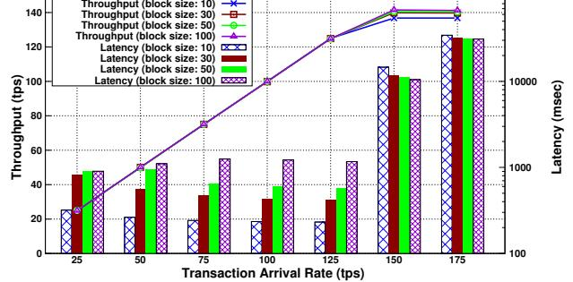

Fig. 4. Impact of the block size and transaction arrival rate on performance.

In the lack of standard benchmarks for Blockchain, we built our own benchmarks by surveying around 12 internal customer solutions built on Fabric for diverse use cases. We identified common defining patterns, data models, and requirements across the board. One of the recurrent pattern is for each chaincode invocation to operate on exactly one asset or unit of data with the identifier being passed to it. The query logic is done by higher level application layers, often without querying blockchain data. This pattern is modelled as simple writeonly transactions (1w, 3w and 5w - denoting number of keys written) in our benchmark. Another common pattern is for a chaincode to read-and-write a small set of keys, like read a JSON document, update a field and write it back. We model these as read-writes of 1, 3 and 5 keys. As we have modeled our benchmark to imitate real world blockchain applications in production, we have not considered other macro benchmarks.

# V. EXPERIMENTAL RESULTS

In this section, we study the impact of various configurable parameters listed in §II-C on the performance of Hyperledger Fabric. The throughput and transaction latency presented in this section are averaged over multiple runs. In total, we conducted more than 1000s of experiments.

# *A. Impact of Transaction Arrival Rate and Block Size*

Figure 4 plots the average throughput and latency for various block sizes over different transaction arrival rates. Table II presents various transaction arrival rates and block sizes used. For other parameters, refer to Table I.

Observation 1: *With an increase in transaction arrival rate, the throughput increased linearly as expected till it flattened out at around 140 tps, the saturation point* as shown in Figure 4. *When the arrival rate was close to or above the saturation point, the latency increased significantly (i.e., from an order of 100s of ms to 10s of seconds)*. This is because the number of ordered transactions waiting in the VSCC queue during validation phase grew rapidly (refer to Figure 5) which affected the commit latency. However, with further increase in

4https://github.com/thakkarparth007/fabric-load-gen

5https://github.com/cendhu/fetch-block

the arrival rate, we observed no impact on the endorsement and broadcast latency but commit latency. This is because VSCC utilized only a single vCPU and hence new transaction proposals utilized other vCPUs on the peer for simulation and endorsement. As a result, only the validation phase became a bottleneck. In this experiment, the endorsement and broadcast latency was around 12 ms and 9 ms, respectively.

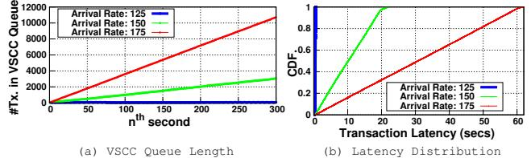

Fig. 5. The length of VSCC queue, and latency distribution for various arrival rates (block size was set to 30).

Observation 2: *For an arrival rate lower than the saturation point, with an increase in the block size, the latency increased*. For e.g., when the arrival rate was 50 tps, with an increase in the block size from 10 to 100, the transaction latency increased 5-fold, from 242 ms to 1250 ms. The reason is that with an increase in the block size, the block creation time at the orderer increased and hence, on average, a transaction had to wait at the orderer for a little longer. For e.g., when the transaction arrival rate was 100 tps, for the block size of 50 and 100, the block creation rate was 2 and 1 block(s) per second, respectively, causing latency to double.

Observation 3: *For an arrival rate greater than the saturation point, with an increase in the block size, the latency decreased.* For e.g., when the arrival rate was 150 tps, with an increase in block size from 10 to 200, the transaction latency decreased from 14 secs to 10 secs. This is because the time taken to validate and commit a block of size n was always lesser than the time taken to validate and commit m blocks each of size n m . As a result, throughput also increased by 3.5%. Note that the block creation rate at orderer node was always greater than the processing rate at validator irrespective of block size and arrival rate.

Observation 4: *For a block size, the latency increases as arrival rate increases below the block size as the threshold. The latency decreases as arrival rate increases above the block size*. For lower block sizes and at higher arrival rates, blocks were created faster (rather than waiting for a block timeout) which reduced the transaction waiting time at the orderer node. In contrast, for instance, when the block size was 100 and arrival rate increased from 25 to 75 tps, the latency increased from 900 ms to 1250 ms. The reason is that with the increase in rate, the number of transactions in a block increased and so did the time taken by validation and commit phase. Note that if block size limit was not reached within a second, a block was created due to a block timeout.

Observation 5: *Even at the peak throughput, the resources utilization was very low*. With an increase in the arrival rate from 25 to 175 tps, the avg CPU utilization merely increased

TABLE III CONFIGURATION TO IDENTIFY THE IMPACT OF ENDORSEMENT POLICIES.

| Parameters         | Values                                           |
|--------------------|--------------------------------------------------|
| Endorsement Pol | 1) OR [a, b, c, d]                               |
| icy (AND/OR)       | 2) OR [AND(a ,b), AND(a, c), AND(a, d), AND(b,   |
|                    | c), AND(b, d), AND(C, D)]                        |
|                    | 3) OR [AND(a ,b, c), AND(a, b, d), AND(b, c, d), |
|                    | AND(a, c, d)]                                    |
|                    | 4) AND [a, b, c, d]                              |
| Endorsement Pol | 1) 1-OutOf [a ,b ,c, d]                          |
| icy (NOutOf)       | 2) 2-OutOf [a ,b ,c, d]                          |
|                    | 3) 3-OutOf [a ,b ,c, d]                          |
|                    | 4) 4-OutOf [a ,b ,c, d]                          |
| Tx. Arrival Rate   | 125, 150, 175 (tps)                              |
|                    |                                                  |
| 200                | 200 600                                       |

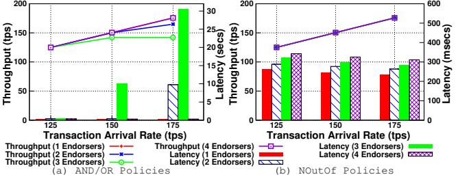

Fig. 6. Impact of different endorsement policies (AND/OR and NOutOf).

from 1.4% to 6.7%6 . The reason is that the CPU intensive task performed during VSCC validation phase of a block (i.e., verification of signatures set against endorsement policy for each transaction) processed only one transaction at a time. Due to this serial execution, only one vCPU was utilized.

Guideline 1: When the transaction arrival rate is expected to be lower than the saturation point, to achieve a lower transaction latency for applications, always use a lower block size. In such cases, the throughput will match the arrival rate.

Guideline 2: When the transaction arrival rate is expected to be high, to achieve a higher throughput and a lower transaction latency, always use a higher block size.

Action Item 1: CPU resources are under-utilized. A potential optimization would be to process multiple transactions at a time during the VSCC validation phase as shown in §VI-B.

# *B. Impact of Endorsement Policy*

Figure 6 plots the throughput and latency for various endorsement policies defined using both AND/OR and NOutOf syntax over different transaction arrival rates. Table III presents various policies used in this study. Note that 'a', 'b', 'c' and 'd' denotes four different organizations. For other parameters, refer to Table I. Though the syntax (AND/OR, NOutOf) used to define the four endorsement policies are different, semantically they are same. For e.g., 3rd policy listed in both syntax denotes that any three organizations endorsement is adequate to pass the VSCC validation.

Observation 6: *A combination of a number of sub-policies and a number of crypto signatures verification impacted the performance* as shown in Figure 6. The 1st and 4th AND/OR policies, having no sub-policies, performed the same

5 arrival rate adjusted to block timeout

6Unless specified otherwise, CPU utilization are specified as an average across 32 vCPUs. In absolute terms, 6.7% is equal to 6.7 × 32 = 214%

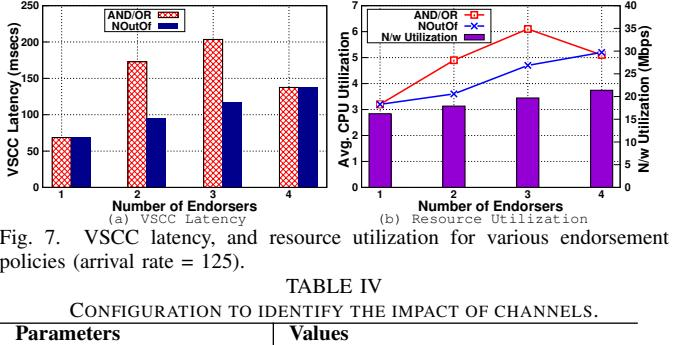

| Number of Channels | 1, 2, 4, 8, 16                    |
|--------------------|-----------------------------------|
| Tx. Arrival Rate   | 125 to 2500 tps with a step of 25 |
|                    |                                   |

as NOutOf policies due to a few signatures verification. With sub-policies, both the number of sub-policies (i.e., search space) and the number of signatures dictated the performance. For e.g., the throughput achieved with 2nd & 3rd AND/OR policies was 7% & 20% lesser than other policies, respectively.

Figure 7 plots the VSCC latency and the resource utilization at a peer node for various policies. With an increase in the number of signatures verification (specifically for NOutOf), the VSCC latency increased linearly from 68 ms to 137 ms. When there were sub-policies (as with 2nd and 3rd AND/OR policies), the VSCC latency increased significantly (i.e., 172 ms and 203 ms, respectively). A similar trend for resource utilization as show in Figure 7(b). Note that the block bytes increased with increase in the number of endorsements due to the number of x.509 certificates encoded in each transaction.

There are three major CPU intensive operations during the policy validation phase (excluding the check for satisfiability) which are listed below.

- 1) Deserialization of identity (i.e., x.509 certificate).
- 2) Validation of identity with organization MSP [9].
- 3) Verification of signature on the transaction data.

Hence, with an increase in the sub-policies (i.e., search space), the number of identities & signatures to be validated, both CPU utilization and VSCC latency increased. It is interesting to note that the MSP identifier is not sent along with x.509 certificate. As a result, the policy evaluator has to validate each x.509 certificate with multiple organization MSPs to identify the correct one. For a 5 minutes run at an arrival rate of 150 tps, we observed 220K such validation out of which 96K validation failed that resulted in wastage of CPU and time.

Guideline 3: To achieve a high performance, define policies with a fewer number of sub-policies and signatures.

Action Item 2: As the cryptography operations are CPU intensive, we can avoid certain routine operations by maintaining a cache of deserialized identity and their MSP information as shown in §VI-A. This does not introduce a security risk as identities are long-lived and separate Certificate Revocation Lists (CRLs) are maintained.

# *C. Impact of Channels and Resource Allocation*

We categorize the arrival rate for different channel count into two categories; non-overloaded when the latency range was [0.4-1s] and overloaded when the latency range was

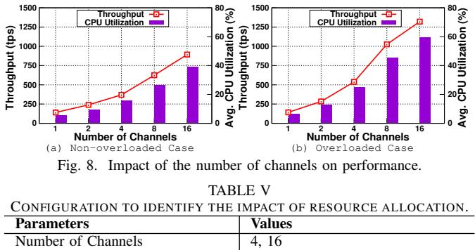

| Number of Channels             | 4, 16                           |
|--------------------------------|---------------------------------|
| Resources (same for all peers) | (2, 4, 8, 16, 32) vCPUs, 3 Gbps |
| Tx. Arrival Rate               | 350 tps for 4 channels          |
|                                | 850 tps for 16 channels         |
|                                |                                 |

[30-40s]. Figure 8 plots the average throughput and CPU utilization for these two categories. Table IV presents a various number of channels and transaction arrival rate used for this study. For other parameters, refer to Table I. All peers joined all the channels as described in §IV.

Observation 7: *With the increase in the number of channels, the throughput increased and latency decreased. The resource utilization such as CPU also increased* as shown in Figure 8. For e.g., with the increase in the number of channels from 1 to 16, the throughput increased from 140 tps to 832 tps (i.e., by 6× in non-overloaded case) and to 1320 tps (i.e., 9.5× in overloaded case). This is because each channel is independent of others and maintains its own chain of blocks. Hence, the validation phase and the final ledger update of multiple blocks (one per channel) executed in parallel which increased CPU utilization that resulted in higher throughput.

Figure 9(a) and (b) plot the throughput, endorsement & commit latency for 4 and 16 channels, respectively, over a different number of allocated vCPUs but homogeneous peers. Figure 9(c) plots the absolute (instead of average) CPU utilization across all vCPUs. Table V presents a various number of vCPUs allocated, the number of channels and transaction arrival rate used. For other parameters, refer to Table I.

Observation 8: *At moderate loads, when the number of vCPUs allocated were lesser than the channel count, performance degraded*. For e.g., When the number of vCPUs allocated were lesser than 16 for 16 channels, the throughput reduced significantly from 848 tps to 32 tps (by 26×) – refer to Figure 9(b). Further, both the average endorsement and commit latency exploded (from 37 ms to 21 s, and 640 ms to 49 s, respectively) due to a lot of contention on the CPU. Further, a significant number of requests got a timeout during the endorsement phase. Once a timeout occurs, we marked that transaction as failed. With an allocation of 2 vCPUs, a higher number of endorsement requests got a timeout as compared to 4 vCPUs. Thus, the endorsement and commit latency (of successful transactions) observed with 2 vCPUs were lesser than 4 vCPUs as shown in Figure 9(b).

Due to the CPU contention, the VSCC latency also increased that affected the commit latency as shown in Figure 9(c). Increasing the vCPUs allocation increased CPU utilization and consequently performance up-to a peak where vCPUs

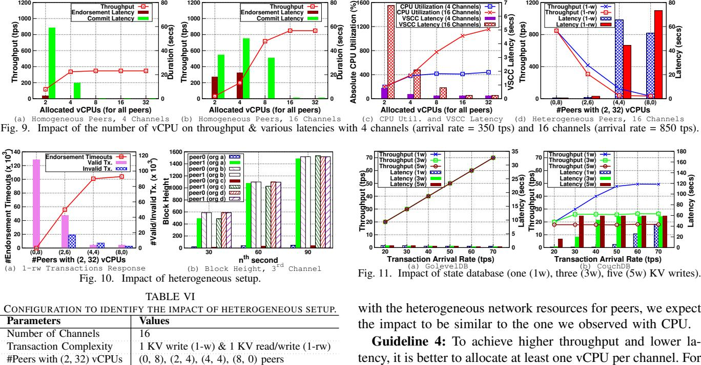

matched the number of channels. Beyond this, additionally allocated vCPUs were idle due to the single-threaded sequential VSCC validation – refer to Figure 9(c).

Tx. Arrival Rate 850 tps

Figure 9(d) plot the throughput and latency for 16 channels in a heterogeneous setup. Table VI presents a various number of vCPUs allocated for different peers to enable heterogeneity, the number of channels, transaction complexity and transaction arrival rate used. For other parameters, refer to Table I.

Observation 9: *At moderate loads, even when the number of vCPUs allocated for 2 peers out of 8 were lesser than the channel count, performance degraded*. For e.g., when only 2 vCPUs were allocated for 2 peers (others with 32 vCPUs), the throughput reduced from 848 tps to 417 tps (by 2×) for write-only transactions and to 307 tps (by 2.7×) for readwrite transactions. The reasons for the reduction are twofold, endorsement requests timeout from less powerful peers and MVCC conflicts specifically for read/write transactions. Figure 10(a) plots the endorsement requests timeout, valid transactions and invalid transactions due to MVCC conflicts for readwrite transactions. With an increase in the number of less powerful peers, the endorsement requests timeout increased. Further, a higher proportion of total submitted transactions became invalid due to MVCC conflicts. The is because of the lower block commit rate at less powerful peers as compared to powerful peers. Due to the different block height at peers (refer to Figure 10(b)), there was a mismatch of key's version in the read-set collected. As a result, MVCC conflicts occurred during the state validation which invalidated transactions.

Though we have not studied the impact of network resources, we believe that the impact would be similar to that of CPU. This is because, with a low network bandwidth, the delay in both the block and transaction delivery would increase. Even

tency, it is better to allocate at least one vCPU per channel. For optimal vCPU allocation, we need to determine the expected load at each channel and allocate adequate vCPUs accordingly.

Guideline 5: To achieve higher throughput and lower latency, it is better to avoid heterogeneous peers as the performance would be dictated by less powerful peers.

Action Item 3: Processing transactions within a channel and across channels can be improved to better utilize additional CPU power as shown in §VI-B.

# *D. Impact of Ledger Database*

Figure 11 plots the average throughput and latency over multiple transaction arrival rates for both GoLevelDB and CouchDB with different transaction complexities. Table VII presents various databases, transaction complexity and arrival rate used. For other parameters, refer to Table I.

Observation 10: *The Fabric transaction throughput with GoLevelDB as state database was 3*× *greater than CouchDB*. The maximum throughput achieved with GoLevelDB on a single channel was 140 tps (refer to Figure 4) while with CouchDB, it was only 50 tps (refer to Figure 11(b)). Further, with an increase in the transaction complexity, i.e., for multiple writes, the throughput with CouchDB dropped from 50 tps to 18 tps while no such impact with GoLevelDB (refer to Figure 11(a)). The reason for significant performance differences between CouchDB and GoLevelDB is that the latter is an embedded database to peer process while former is accessed using REST APIs over a secure HTTP. As a result, the endorsement latency, VSCC latency, MVCC latency and the ledger update latency was higher with CouchDB as compared to the GoLevelDB as shown in Figure 12(a) & (b). With CouchDB, the VSCC latency increased compared to the GoLevelDB as the peer accessed state database using a REST API call for every transaction to retrieve the endorsement policy of the

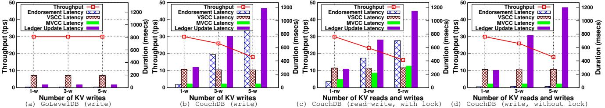

Fig. 12. Impact of database on throughput, endorsement, VSCC, MVCC, & ledger update latency for various transaction complexities (arrival rate = 30 tps)

| TABLE VII                                               |                            |  |
|---------------------------------------------------------|----------------------------|--|
| CONFIGURATION TO IDENTIFY THE IMPACT OF STATE DATABASE. |                            |  |
| Parameters                                              | Values                     |  |
| Database                                                | GoLevelDB, CouchDB         |  |
| Transaction Complexity                                  | • (1, 3, 5) KV writes      |  |
|                                                         | • (1, 3, 5) KV read/writes |  |
| Tx. Arrival Rate                                        | 20, 30, 40, 50, 60 (tps)   |  |

chaincode on which the transaction was simulated. Similarly, the MVCC latency also increased with CouchDB.

Observation 11: *With CouchDB, the endorsement latency and ledger update latency increased with an increase in the number of writes per transaction*, i.e., from 40 ms and 240 ms with one write to 800 ms and 1200 ms with three writes, respectively, as shown in Figure 12(b) even though write-only transactions do not access the database during the endorsement phase. This is because the endorsement phase acquired a shared read lock on the whole database to provide a consistent view of data (i.e., *repeatable read isolation level [17]*) to the chaincode. Similarly, the final ledger update phase acquired an exclusive write lock on the whole database. Hence, both the endorsement phase and final ledger update contended for this resource. Especially, the final ledger update with CouchDB was costlier as it had to perform the following three tasks for each key-value write in a transaction's write-set.

- 1) Retrieve the key's previous revision number (used for concurrency control within CouchDB) by issuing a GET request, if it exists in the database.
- 2) Construct a document for the value (could be a JSON document or binary attachment).
- 3) Update the database by submitting a PUT request.

As a result, with the increase in the number of writes per transaction, the ledger update latency increased (refer to Figure 12(b)). Due to the above three time consuming serial operations, we surmise that the committer held the lock on the database for a longer duration which increased endorsement latency. To validate our hypothesis, we performed experiments by disabling the lock acquisition on the whole database during the endorsement phase and final ledger update. The side effect of such action was only providing *non-repeatable read isolation level* at that chaincode. As our transaction was only writing keys, such side effect did not affect the database consistency. Figure 12(d) shows the improvement in endorsement phase. The average endorsement latency reduced from 800 ms to 40 ms, validating our hypothesis.

Observation 12: *Only with an increase in the number of reads per transaction, the MVCC latency increased* as shown in Figure 12(c). This is because with an increase in the number of items in the read set, the number of GET REST API calls to CouchDB increased during MVCC validation phase. With an increase in the number of writes, MVCC latency did not increase as shown in Figure 12(b) because it only checks whether any read keys has been modified.

Guideline 6: GoLevelDB is a better performant option for state database. CouchDB is a better choice if rich-query support for read-only transactions is important. When using CouchDB, design the application and transaction to read/write a fewer number of keys to accomplish a task.

Action Item 4: CouchDB supports bulk read/write operations [3] without additional transactional semantics. Using the bulk operations will reduce the lock holding duration and improve the performance as demonstrated in §VI-C.

Action Item 5: The usage of database such as GoLevelDB and CouchDB, without the snapshot isolation level, results in whole database lock during the endorsement and the ledger update phase. Hence, our future work [11] is to look at ways to remove the lock and/or use a database such as PostgreSQL [12] that supports snapshot isolation.

# *E. Scalability and Fault Tolerant*

In Fabric, scalability can be measured in terms of the number of channels, number of organizations joining a channel and the number of peers per organization. From a resource consumption perspective, the endorsement policy complexity controls the scalability of network. Even with a large number of organizations or peers, if the endorsement policy requires only a few organizations signature, then the performance would be the unaffected. This is because, the transaction needs to be simulated at a fewer node in the network to collect endorsement. Scalability could also be defined in terms of number of geographically distributed nodes and latency in block dissemination among them. Number of ordering service nodes and choice of consensus protocol used among them would also affect scalability. Though these are out of scope of this study, are important aspects of network scalability.

Node failures are common in a distributed system and hence, it is important to study the fault tolerant capability of Fabric. In our initial and early study, we observed that node failures do not affect the performance (during non-overloaded case) as client can collect endorsement from other available nodes. With higher loads, node rejoining after a failure and syncing up the ledger due to missing blocks was observed to have large delays. This is because though the block processing rate at the rejoined node was at the peak, other nodes continues to add new blocks at the same peak processing rate.

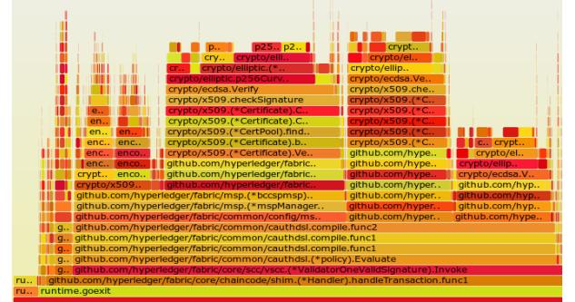

Fig. 14. Frequency and call stack depth of crypto operations (3rd policy in AND/OR) – without the MSP cache

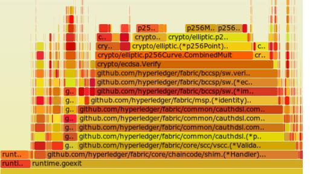

Fig. 15. Frequency and call stack depth of crypto operations (3rd policy in AND/OR) – with the MSP cache.

# VI. OPTIMIZATIONS STUDIED

In this section, we introduce three simple optimizations based on action items listed in §V – (1) MSP cache in §VI-A, (2) parallel VSCC validation of a block in §VI-B, and (3) bulk read/write7 during MVCC validation & commit for CouchDB in §VI-C. For each of these optimizations, first, we study the performance improvement individually. Then, we study the improvement by combining all the three optimizations.

*A. MSP Cache*

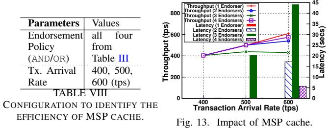

As crypto operations are very CPU intensive, in this section, we studied the efficiency of using a cache at the following two operations in the crypto module:

1) Deserialization of identity (i.e., x.509 certificate).

2) Validation of identity with Organization's MSP.

To avoid deserialization of the serialized identity every time, we cached the deserialized identity using a hash map with the serialized form as key. Similarly, to avoid validating an identity with multiple MSPs every time, we used a hash map with a

7A Fabric community proposal and an implementation of bulk operation API was available but was not integrated with MVCC and the final commit

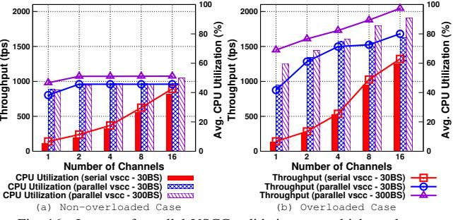

Fig. 16. Impact of parallel VSCC validation on multichannel setup.

key as identity and value as the corresponding MSP to which the identity belongs. Further, we employed the ARC [27] algorithm for cache replacement. During identity revocations, we invalidated cache entries appropriately.

Figure 13 plots the impact of MSP cache on the throughput and latency for AND/OR endorsement policies over different transaction arrival rates. Table III presents various policies used along with different transaction arrival rates. We draw the attention of the reader to Figure 6(b) for comparison against the no-cache behavior. On average, the throughput increased by 3× due to MSP cache as compared to a vanilla peer. For e.g., when the endorsement policy required signature from two endorsers (defined using AND/OR syntax), the maximum throughput achieved without MSP cache was 160 tps while with cache, it increased to 540 tps. This is because the MSP cache reduced certain repetitive CPU intensive operations.

Figure 14 and 15 plots the flame graph showing frequency of crypto operations and call stack depth of VSCC validation phase in a vanilla peer and a peer with MSP cache, respectively. As it can be observed, the number of crypto operations and call stack depth reduced significantly with the MSP cache.

# *B. Parallel VSCC Validation of a Block*

The VSCC validation phase validates each transaction in a block serially against the endorsement policy. As this approach under-utilized the resources, we studied the efficiency of parallel validation, i.e., validate multiple transactions' endorsement in parallel to utilize otherwise idle CPU and improve the overall performance. To achieve this, we created a configurable number of worker threads per channel on peer startup. Each worker thread validates one transaction's endorsement signature set against its endorsement policy.

Figure 16 plots the impact of parallel VSCC on the performance and resource utilization. We categorize the arrival rate for different channel count into two categories; non-overloaded case when the latency falls in [0.1-1s] and overloaded when the latency falls in [30-40s]. For each channel, we allocated worker threads equal to the block size. The throughput and resource utilization during the non-overloaded case for one channel exploded from 130 tps to 800 tps (improved by 6.3×) for the block size of 30 and to 980 tps (7.5×) for the block size of 300. This is due to parallel validation and hence the reduction in the VSCC latency (from 300 ms to 30 ms, i.e., by 10× reduction for the block size of 30). The throughput

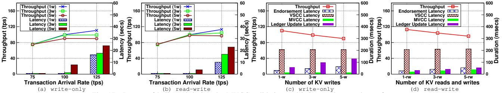

Fig. 17. Impact of bulk read during the MVCC validation and ledger update on the performance.

saturated at 950 tps (for the block size of 30) & 1075 tps (for the block size of 300) – refer to Figure 16(a).

Similarly, the throughput and resource utilization during the overloaded case increased to 1.5× for 16 channels to as much as 10× for 1 channel – refer to Figure 16(b). This shows that parallel VSCC validation of a block significantly increases the performance of a single channel. With an increase in the number of channels, the percentage of improvement decreased. This is because multiple channels by default result in the parallel validation of blocks (instead of transactions) and hence a few number of free vCPUs were available for parallel VSCC.

# *C. Bulk Read/Write During MVCC Validation & Commit*

During the MVCC validation, with CouchDB as the state database, for each transaction in a block, for each key in the read set of the transaction, a GET REST API call to the database over a secure HTTPS retrieved the last committed version number. During the commit phase, for each valid transaction (recorded after MVCC validation) in a block, for each key in the write set of the transaction, a GET REST API call retrieved the revision numbers [4]. Finally, for each entry in the write set, a PUT REST API call committed the document. Due to these multiple REST API calls, performance degraded significantly as demonstrated in §V-D.

To cut down the number of REST API calls, CouchDB suggests using bulk operations. Hence, we used the existing BatchRetrieval API in Fabric to batch load multiple keys' version and revision number into the cache over a single GET REST API call per block. To enhance the ledger update process, we used BatchUpdate API in Fabric to commit a batch of documents using a single PUT REST API call per block. Further, we introduced a cache in VSCC to reduce the calls to CouchDB to obtain the endorsement policy of the chaincode for each transaction. In this section, we show the efficiency of these enhancements on the overall performance.

Figure 17 plots the throughput and latency when running a CouchDB as the state database with the bulk read/write optimization. For comparison against the non-bulk read/write, refer to Figure 11(b) and Figure 12. The performance increased significantly from 50 tps to 115 tps (i.e., by 2.3×) for transactions with a single write. For multiple writes (3-w & 5-w), the throughput increased from 26 tps to 100 tps (i.e., 3.8× for 3-w), and 18 tps to 90 tps (i.e., 5× for 5-w). We noticed similar improvements for read-write transactions.

Due to the bulk read/write optimization, the MVCC latency, ledger update latency and endorsement latency decreased as shown in Figure 17(c) and (d) as compared to Figure 12. The

TABLE IX CONFIGURATION TO IDENTIFY THE IMPACT OF ALL THREE OPTIMIZATIONS COMBINED.

| Parameters                | Values                              |
|---------------------------|-------------------------------------|
| Number of Channels        | 1, 8, 16                            |
| Transaction Complexity    | 1 KV write (1-w) of 20 bytes        |
| StateDB Database          | GoLevelDB, CouchDB                  |
| Peer Resources            | 32 vCPUs, 3 Gbps link               |
| Endorsement Policy        | st and 3 rd AND/OR policies 1 |
| Block Size                | 100, 300, 500 (#tx)                 |
| #VSCC Workers per Channel | Equal to the block size             |

reduction in endorsement latency (by at least 3×) was because of the reduction in lock holding duration by the commit phase (by at least 8×). The MVCC latency for read-write transactions reduced (by at least 6×) due to a bulk reading of all keys in the read set of all transactions in a block. Note that the MVCC latency increased with the increase in the number of keys read in a bulk read. The ledger update latency of a block encompassing a higher number of writeonly transactions was higher. This is because, in read-write transactions, the MVCC validation phase itself loaded the required revision numbers into the cache (as the transaction read those keys before modification) which was not the case with write-only transactions.

# *D. Combinations of Optimizations*

Figure 18 plots the performance improvement achieved with all three optimizations combined. Table IX presents the number of VSCC worker threads per channel, block sizes, and other relavant parameters used for this study.

With GoLevelDB as the state database, the single channel throughput increased to 2250 tps from 140 tps (i.e., 16× improvement) due to all three optimizations – refer to Figure 18(a) and Figure 4. Similarly, with CouchDB as the state database, the singe channel throughput increased to 700 tps from 50 tps (i.e., 14× improvement) – refer to Figure 18(b) and Figure 11. With an increase in the block size, when CouchDB was the state database, we observed a lower total latency due to the reduction in the number of bulk REST API call to CouchDB (i.e, for 500 transactions, only 2 bulk REST API calls, one read call during MVCC phase and one write during commit phase, were issued when the block size was 500 as compared to 10 bulk REST API calls for a block size of 100). As a result, our guideline 1 & 2 are not applicable for CouchDB with bulk read/write optimizations.

Further, for 8 and 16 channels, the throughput increased to 2700 tps from 1025 tps and 1321 tps, respectively as shown in Figure 19(a). With a simpler endorsement policy, i.e., 1 st

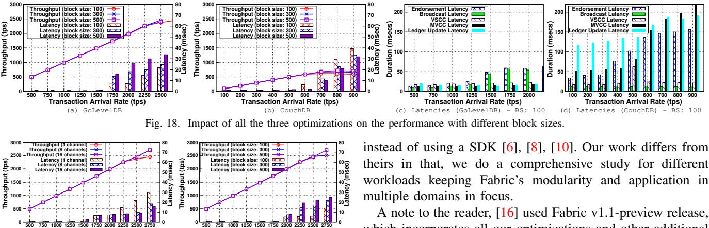

 **10**

A note to the reader, [16] used Fabric v1.1-preview release, which incorporates all our optimizations and other additional functionalities over v1.0. However, being a minor version update much of the core functionality remains the same and our observations hold true for v1.1 and future versions based on the new architecture of Fabric.

# VIII. CONCLUSION & FUTURE WORK

In this paper, we conducted a comprehensive empirical study to understand the performance of Hyperledger Fabric, a permissioned blockchain platform, by varying values assigned to configurable parameters such as block size, endorsement policy, channels, resource allocation, and state database choices. As a result of our study, we provided six valuable guidelines on configuring these parameters and also identified three major performance bottlenecks. Hence, we introduced and studied three simple optimizations such as MSP cache, parallel VSCC validation, and bulk read/write during MVCC validation & commit phase to improve the singe channel performance by 16×. Further, these three optimizations have been successfully adopted in Fabric v1.1

As a part of future work, we will study the scalability and fault tolerant capability of Fabric by using different blockchain topologies such as different number of organizations and different number of nodes per organization. Further, we plan to quantify the impact of various consensus algorithms and number of nodes in the ordering service on the performance of different workloads. In our study, we assumed that the network is not a bottleneck. However, in the real world setup, nodes can be geographically distributed and hence, the network might play a role. In addition, the arrival rates in real world production system would be following certain distributions. Hence, we will study the performance of Fabric in Wide Area Network (WAN) with different arrival rate distributions.

# IX. ACKNOWLEDGEMENTS

We wish to acknowledge our following colleagues for their valuable assistance to our work. Our proposed optimizations were successfully adopted to Fabric, thanks to fabric developers who took care of submitting patches to Fabric v1.1. Angelo De Carlo (MSP Cache), Alessandro Sorniotti (Parallel Validation). Thanks to David Enyeart, Chris Elder, Manish Sethi for their proposal on Bulk Read from CouchDB. We would like to thank Yacov Manevich for his consistent help.

Fig. 19. Impact of all the three optimizations on the performance with a simple endorsement policy and different number of channels.

 **0 500**

**500 750 1000 1250 1500 1750 2000 2250 2500 27500**

**Transaction Arrival Rate (tps)**  (b) Single Channel, 1st AND/OR policy

**Transaction Arrival Rate (tps)**  (a) Multi-Channel, 3rd AND/OR policy, BS: 100

AND/OR policy, the single channel throughput also increased to 2700 tps (with GoLevelDB) as shown in Figure 19(b).

Even with a throughput of 2700 tps, the average CPU utilization of a peer was only 60% and the network utilization of a peer was 1680 Mbps (send) and 240 Mbps (receive). This is because the sum of MVCC latency and ledger update latency (less CPU intensive tasks) was almost same or higher than the VSCC latency (as shown in Figure 18(c) and (d)). Due to these sequential phases, vCPUs were underutilized. One potential optimization would be to pipeline the VSCC and MVCC validation phase.

# VII. RELATED WORK

There has been considerable interest in the scalability and performance characteristics of public blockchain networks and specifically the limiting factor of the consensus protocol and its security implications [31], [23].

Also for public blockchains, [19] have looked at quantifying throughput, latency, bootstrap time and cost per transaction for the Bitcoin network based on publicly available data.

BlockBench [22] was one of the first to look at permissioned blockchain. They present a framework for comparing performance of different blockchain platforms, namely, Ethereum, Parity and Hyperledger Fabric using a set of micro and macro benchmarks. Similar to [19] they generalize consensus, data, execution and application as 4 layers of blockchain and use the benchmarks to exercise them. They measure the overall performance in terms of throughput, latency and scalability of the platforms and draw conclusions across the 3 platforms. However, they studied the performance of Fabric v0.6, with v1.0 version bringing in a complete re-design, their observations do not hold relevance and needs re-study.

[16] presents the design and the new architecture of Fabric, delving in-depth into its design considerations and modularity. It presents the performance of a single Bitcoin like crypto currency application on Fabric, called Fabcoin, which uses a customized VSCC to validate the Fabcoin specific transactions and avoid complex endorsements and channels. Further, they used CLI command to emulate clients, which is not realistic,

# REFERENCES

- [1] Chaincodes. http://hyperledger-fabric.readthedocs.io/en/release-1.1/ chaincode4noah.html. [Online; accessed 1-May-2018].
- [2] CouchDB. http://couchdb.apache.org/. [Online; accessed 1-May-2018].
- [3] CouchDB: Bulk API. http://docs.couchdb.org/en/2.0.0/api/database/ bulk-api.html. [Online; accessed 1-May-2018].
- [4] CouchDB: Document Revision Number. http://docs.couchdb.org/en/2.0. 0/intro/api.html?highlight=revision#revisions. [Online; accessed 1-May-2018].
- [5] Everledger A Digital Global Ledger. https://www.everledger.io/. [Online; accessed 1-May-2018].
- [6] Go SDK for Fabric Client/Application. https://github.com/hyperledger/ fabric-sdk-go. [Online; accessed 1-May-2018].
- [7] GoLevelDB. https://github.com/syndtr/goleveldb. [Online; accessed 1- May-2018].
- [8] Java SDK for Fabric Client/Application. https://github.com/hyperledger/ fabric-sdk-java. [Online; accessed 1-May-2018].
- [9] Membership Service Providers (MSP). http://hyperledger-fabric. readthedocs.io/en/release-1.1/msp.html. [Online; accessed 1-May-2018].
- [10] Node SDK for Fabric Client/Application. https://github.com/ hyperledger/fabric-sdk-node. [Online; accessed 1-May-2018].
- [11] PostgreSQL as the State Database for Hyperledger Fabric. https://jira. hyperledger.org/browse/FAB-8031. [Online; accessed 1-May-2018].
- [12] PostgreSQL Database Management System. https://github.com/postgres/ postgres. [Online; accessed 1-May-2018].
- [13] The Linux Foundation Helps Hyperledger Build the Most Vibrant Open Source Ecosystem for Blockchain. http://www.linuxfoundation.org/. [Online; accessed 1-May-2018].
- [14] Quorum: an Ethereum-forked variant Blockchain. https: //github.com/jpmorganchase/quorum-docs/blob/master/Quorum% 20Whitepaper%20v0.1.pdf, 2016. [Online; accessed 1-May-2018].
- [15] SecureKey: Building Trusted Identity Networks. https://securekey.com/, 2017. [Online; accessed 1-May-2018].
- [16] E. Androulaki, A. Barger, V. Bortnikov, C. Cachin, K. Christidis, A. De Caro, D. Enyeart, C. Ferris, G. Laventman, Y. Manevich, S. Muralidharan, C. Murthy, B. Nguyen, M. Sethi, G. Singh, K. Smith, A. Sorniotti, C. Stathakopoulou, M. Vukolic, S. Weed Cocco, and ´ J. Yellick. Hyperledger Fabric: A Distributed Operating System for Permissioned Blockchains. *ArXiv e-prints*, Jan. 2018.
- [17] H. Berenson, P. Bernstein, J. Gray, J. Melton, E. O'Neil, and P. O'Neil. A critique of ansi sql isolation levels. In *Proceedings of the 1995 ACM SIGMOD International Conference on Management of Data*, SIGMOD '95, pages 1–10, New York, NY, USA, 1995. ACM.
- [18] M. Castro and B. Liskov. Practical byzantine fault tolerance. In *Proceedings of the Third Symposium on Operating Systems Design and Implementation*, OSDI '99, pages 173–186, Berkeley, CA, USA, 1999. USENIX Association.
- [19] K. Croman, C. Decker, I. Eyal, A. E. Gencer, A. Juels, A. E. Kosba, A. Miller, P. Saxena, E. Shi, E. G. Sirer, D. X. Song, and R. Wattenhofer. On scaling decentralized blockchains. 2016.
- [20] C. Dannen. *Introducing Ethereum and Solidity: Foundations of Cryptocurrency and Blockchain Programming for Beginners*. Apress, Berkely, CA, USA, 1st edition, 2017.
- [21] D. D. Detwiler. One nations move to increase food safety with blockchain. https://www.ibm.com/blogs/blockchain/2018/02/ one-nations-move-to-increase-food-safety-with-blockchain/, 2018. [Online; accessed 1-May-2018].
- [22] T. T. A. Dinh, J. Wang, G. Chen, R. Liu, B. C. Ooi, and K.-L. Tan. Blockbench: A framework for analyzing private blockchains. In *Proceedings of the 2017 ACM International Conference on Management of Data*, SIGMOD '17, pages 1085–1100, New York, NY, USA, 2017. ACM.
- [23] A. Gervais, G. O. Karame, K. Wust, V. Glykantzis, H. Ritzdorf, ¨ and S. Capkun. On the security and performance of proof of work blockchains. In *Proceedings of the 2016 ACM SIGSAC Conference on Computer and Communications Security*, pages 3–16. ACM, 2016.
- [24] J. Gottlieb, E. Marchiori, and C. Rossi. Evolutionary algorithms for the satisfiability problem. *Evol. Comput.*, 10(1):35–50, Mar. 2002.
- [25] M. Hearn. Corda: A distributed ledger. https://docs.corda.net/ static/ corda-technical-whitepaper.pdf, 2016. [Online; accessed 1-May-2018].
- [26] F. Keller. New collaboration on trade finance platform built on blockchain. https://www.ibm.com/blogs/blockchain/2017/10/ new-collaboration-on-trade-finance-platform-built-on-blockchain/, 2017. [Online; accessed 1-May-2018].
- [27] N. Megiddo and D. S. Modha. Arc: A self-tuning, low overhead replacement cache. In *Proceedings of the 2Nd USENIX Conference on File and Storage Technologies*, FAST '03, pages 115–130, Berkeley, CA, USA, 2003. USENIX Association.
- [28] S. Nakamoto. Bitcoin: A peer-to-peer electronic cash system, http://bitcoin.org/bitcoin.pdf.
- [29] S. Omohundro. Cryptocurrencies, smart contracts, and artificial intelligence. *AI Matters*, 1(2):19–21, Dec. 2014.
- [30] C. H. Papadimitriou and P. C. Kanellakis. On concurrency control by multiple versions. *ACM Trans. Database Syst.*, 9(1):89–99, Mar. 1984.
- [31] M. Vukolic. The quest for scalable blockchain fabric: Proof-of-work vs. ´ bft replication. In *International Workshop on Open Problems in Network Security*, pages 112–125. Springer, 2015.
- [32] M. Vukolic. Rethinking permissioned blockchains. In ´ *Proceedings of the ACM Workshop on Blockchain, Cryptocurrencies and Contracts*, BCC '17, pages 3–7, New York, NY, USA, 2017. ACM.
- [33] M. White. Digitizing Global Trade with Maersk and IBM. https://www.ibm.com/blogs/blockchain/2018/01/ digitizing-global-trade-maersk-ibm/, 2018. [Online; accessed 1- May-2018].